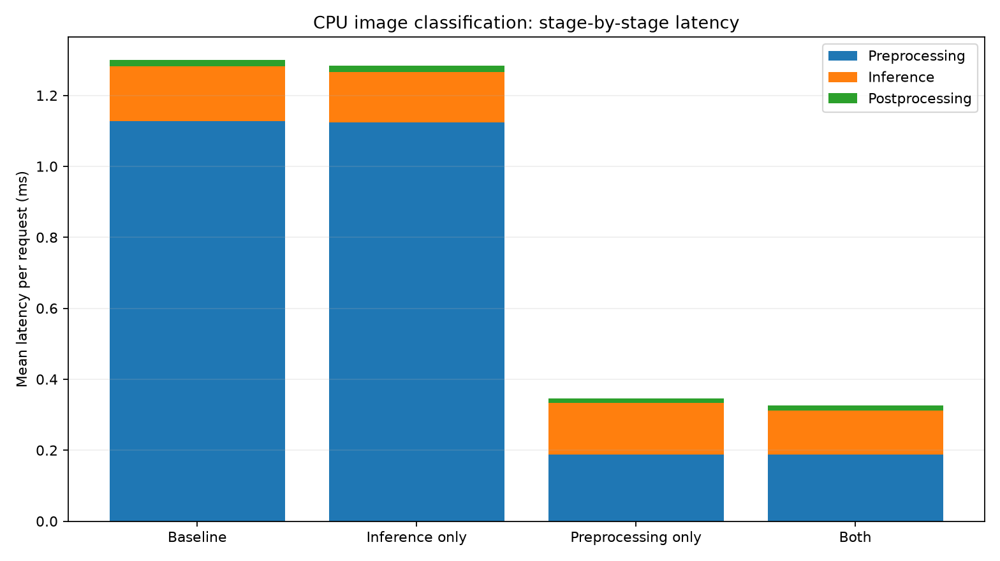

# Measured CPU classifier latency report

> Real measurements on **this benchmark host**, not predictions for a user's laptop.
> A generated, easy three-class pattern dataset is used; do not interpret its
> accuracy as evidence of real-world vision model quality.

## Experiment metadata

- Platform: `Windows-11-10.0.26300-SP0`
- Python: `3.12.10`; PyTorch: `2.15.0+cpu`
- CPU threads used by PyTorch: `1`; logical CPUs reported: `12`
- Input: red_horizontal.png (7575 bytes, loaded once into RAM)
- Warmup iterations per variant: 20; measured iterations per variant: 100; rounds: 3
- Checkpoint training accuracy: 100.0%; validation accuracy: 100.0%
- Optimized model engine: `traced`
- Prediction: `red_horizontal` (confidence 0.9998)
- **Excluded:** file I/O, training, model loading, trace compilation, and service/network costs.

## Results (milliseconds per request)

All stage columns show **means**. End-to-end median and p95 are also reported.
The stage means sum to the corresponding end-to-end mean by construction.
A negative improvement means the change made things slower.

| Case | Preprocess mean | Inference mean | Postprocess mean | E2E mean | E2E median | E2E p95 | Mean E2E improvement |
|---|---:|---:|---:|---:|---:|---:|---:|
| baseline | 1.127 | 0.155 | 0.017 | 1.299 | 1.255 | 1.569 | +0.00% |
| inference_only | 1.124 | 0.141 | 0.018 | 1.283 | 1.237 | 1.499 | +1.25% |
| preprocess_only | 0.188 | 0.145 | 0.014 | 0.347 | 0.319 | 0.498 | +73.33% |
| both | 0.187 | 0.124 | 0.015 | 0.326 | 0.301 | 0.457 | +74.89% |

## Where was the time spent?

At baseline, **preprocessing_ms** accounted for **86.74%** of mean end-to-end latency.
Preprocessing: 86.74%; inference: 11.94%; postprocessing: 1.32%.

The larger E2E improvement among the single-stage experiments was **preprocess_only**.
Actual changes can deviate from Amdahl projections because CPU caching,
allocator activity, operating-system scheduling and measurement noise affect the
other stages too.

## Amdahl's Law

For stage baseline fraction `f` and stage-only local speedup `s`,

`S_total = 1 / ((1 - f) + f / s)`

- Inference-only: `f = 0.1194`, `s = 1.096x`.
  Predicted E2E speedup **1.011x**, predicted improvement **+1.05%**.
- Preprocess-only: `f = 0.8674`, `s = 5.992x`.
  Predicted E2E speedup **3.606x**, predicted improvement **+72.27%**.

Amdahl's **hard upper bound** from making inference infinitely fast is:
`S_max_inference = 1 / (1 - f_inference) = 1.136x`.
No inference implementation alone can beat this bound while other stages stay unchanged.

## Iron Law (simple, serial-pipeline engineering approximation)

`T_end_to_end = T_pre + T_inference + T_post`

Each stage consumes some combination of: moving data (`D / bandwidth`),
arithmetic (`FLOPs / effective_compute_rate`), and overhead (`L`).
Thus `T_stage ≈ T_data + T_compute + T_overhead` is an explanatory,
non-overlapping *approximation*, not an exact hardware identity.

- Python's per-pixel preprocessing performs thousands of interpreted operations,
  repeated scalar conversions, and temporary-list work, so overhead dominates.
- NumPy vectorization moves the same pixels in optimized native loops, reducing
  interpreter overhead and often improving locality.
- Optimizing the model execution path reduces some dispatcher overhead, but has limited impact
  if model inference is a small share of end-to-end time.

## How to read this experiment correctly

This intentionally contrasts a **correct but beginner-level preprocessing
implementation** with a vectorized implementation. It demonstrates the
consequences of choosing the wrong optimization target; it is not a realistic
estimate of the preprocessing cost in an already well-optimized production
service. `torch.jit.trace` is used for the educational inference-only comparison;
TorchScript is deprecated. For a modern alternative, rerun with
`--optimized-engine compiled`, and measure `torch.compile` cold-start costs
separately. Compiler support and results depend on your platform.

Re-run on your laptop and commit **your own** `benchmark.json`,
`timings.csv`, and `latency_breakdown.png` to document your hardware.
